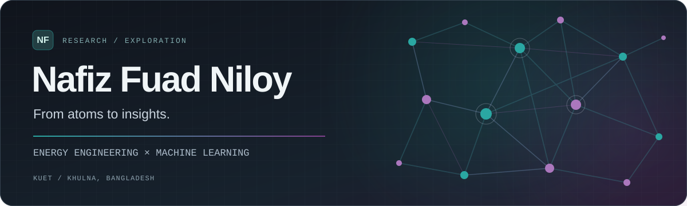

<!-- Nafiz Fuad Niloy | GitHub profile README -->

  

  <strong>Undergraduate Researcher · Energy Engineering × Machine Learning</strong> 
  Khulna University of Engineering & Technology (KUET) · Bangladesh

  <a href="https://nf-niloy.github.io/">Portfolio</a>
  &nbsp;·&nbsp;
  <a href="https://nf-niloy.github.io/#research">Research</a>
  &nbsp;·&nbsp;
  <a href="https://nf-niloy.github.io/#work">Projects</a>
  &nbsp;·&nbsp;
  <a href="https://linktr.ee/niloynf9">Connect</a>

---

### 01 / About

I am a final-year **Energy Science and Engineering** undergraduate at **Khulna University of Engineering & Technology (KUET)**, working at the intersection of **machine learning, computational materials science, and energy engineering**.

I am particularly interested in how graph-based learning and physics-informed approaches can help us understand, model, and discover materials.

### 02 / Current Research

**Reliability-Aware Graph Learning for the Discovery of Lead-Free Halide Perovskite Photovoltaic Absorbers**  
*Undergraduate thesis · 2026–2027 · Ongoing*

Exploring crystal graph neural networks and reliability-aware machine learning for materials-property prediction and the identification of promising lead-free halide perovskite absorbers. The research is ongoing; unpublished methodology and results are not included here.

[Research overview →](https://nf-niloy.github.io/#research)

### 03 / Selected Work

| Project | What it explores |
| :--- | :--- |
| **[Neutron Transport with Physics-Informed Neural Networks](https://github.com/nf-niloy/surrogate-neutron-transport)** | PINNs for 1D, 2D, and coupled two-group neutron diffusion problems. |
| **[Intelligent Battery Thermal Management](https://github.com/nf-niloy/arduino-battery-thermal-management)** | Arduino-based dual-sensor monitoring, multi-stage thermal protection, and automated cooling. |
| **[Research Portfolio](https://github.com/nf-niloy/nf-niloy.github.io)** | An Astro-built academic website with selected projects and a research notebook. |

### 04 / Research Directions

`Materials Discovery` &nbsp; `Graph Neural Networks` &nbsp; `AI for Science`  
`Molecular Machine Learning` &nbsp; `Density Functional Theory` &nbsp; `Energy Materials`

### 05 / Tools & Technologies

**Scientific computing:** Python · PyTorch · NumPy · SciPy · Matplotlib  
**Engineering & development:** Arduino · Git · Astro

### 06 / Elsewhere

- **Website & research notes:** [nf-niloy.github.io](https://nf-niloy.github.io/)
- **Contact and social links:** [Linktree](https://linktr.ee/niloynf9)

Open to research opportunities and collaboration. · Last refreshed October 2026.
